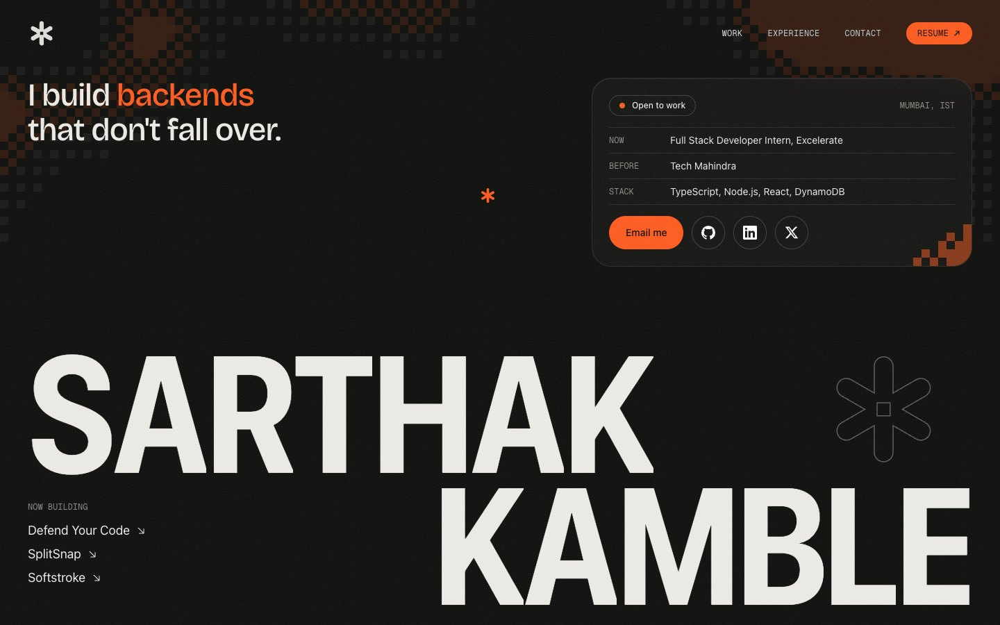

<p align="center">
  
</p>

<h1 align="center">Sarthak Kamble</h1>

<p align="center">
  Full-stack developer. I build backends that don't fall over.
</p>

<p align="center">
  <a href="https://sarthak-kamble.vercel.app"><strong>Open the site</strong></a>
  &nbsp;·&nbsp;
  <a href="https://sarthak-kamble.vercel.app/play">Play Pip</a>
</p>

<p align="center">
  
</p>

## What's on it

My personal site, with a dark, cinematic look and one signal-orange accent.

- **Work.** Each project opens into a panel with a short summary, its stack, a live link and a screen-recorded demo.
- **Experience.** Roles stacked as you scroll, with what I built and the stack I used.
- **Status card.** Where I work now, my stack, and quick links to email, GitHub, LinkedIn and X.
- **Resume.** One click from the nav, as a PDF.
- **Pip.** A five-level pixel platformer hidden in the site. Click the asterisk in the hero, or Pip on the footer line, and fall through a portal into level 1. Finish the game for a message at the end.

## Pip, the game

- Five levels with a checkpoint, a hidden spark block that makes Pip big, and three lives each.
- Keyboard: ← → or A D to move, Space to jump, Esc for the level list, M to mute. On touch screens there are on-screen buttons.
- Plain canvas 2D and Web Audio, with no game libraries. Progress and mute are saved in the browser.

## Tech

- **Next.js** (App Router) and **TypeScript**, exported as a static site and hosted on **Vercel**
- **Tailwind CSS v4** for styles
- **GSAP** (ScrollTrigger, SplitText, ScrambleText) and **Lenis** for motion and smooth scrolling
- Canvas 2D for the pixel field, loader, portal and the game

## Project structure

```
src/app/         Routes, layout and global styles (/ and /play)
src/components/  Page sections and UI
src/data/        Site content, including the project list
src/game/        Pip: engine, levels, sprites and sound
src/lib/         Shared helpers
public/videos/   Project demo videos
brand/           Logo kit and brand guidelines
docs/            Images for this README
```

## Running locally

You need Node 22 and pnpm.

```
pnpm install
pnpm dev
```

Don't run `pnpm build` while `pnpm dev` is running: both use `.next`.

## Adding a project

Add it to `src/data/site.ts`. Set `video` to an mp4 in `public/videos` (1600×1000 works well) and `href` to its live link. Without a video, an animated concept preview is shown instead.

## Checks

```
pnpm lint        ESLint
pnpm typecheck   TypeScript
pnpm build       Static export into out/
```
